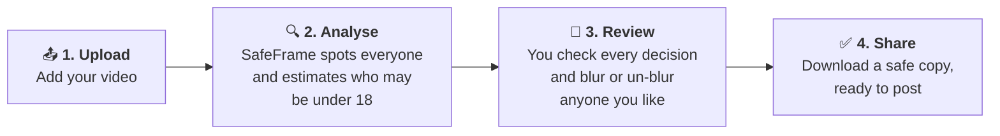

# 🛡️ SafeFrame

### Share your memories — not other people's children.

*An IE Challenge project by the SafeFrame Crew*

<!--
  BEFORE / AFTER GIF GOES HERE.
  Save the file as docs/media/before-after.gif and replace this comment with:
  

  Use stock or consented footage only, never real children without permission.
-->

---

## In one sentence

**SafeFrame is a tool that automatically blurs children in a video before it is
posted online, while a person always has the final say on what gets shared.**

---

## 📉 The problem

Every day, millions of videos are filmed at school plays, birthday parties,
football matches, parks and holidays, and then posted online. Most of them
include children. Some of those children belong to the person filming. Many do
not.

Once a child's face is online, it is very hard to take it back. A clip can be
copied, re-shared, searched and stored for years. The child had no say in it and
may only find out much later.

### The numbers

| | |
|---|---|
| **~1,500** | photos the average UK parent has posted of their child by the child's **fifth birthday**. Only **16 %** of parents always ask permission before posting a photo of someone else.[1] |
| **81 %** | of children across ten countries (including the UK, France, Spain and the US) already had a digital footprint **before age two**. In the US the figure was **92 %**.[2] |
| **74 %** | of parents of young children know another parent who has **shared too much** about a child online. **51 %** had seen posts revealing where a child could be found, and 27 % had seen inappropriate photos.[3] |
| **2×** | Children were **twice as likely as their parents** to worry about family members posting about them without permission. Asking permission first was the most common rule they wanted.[4] |
| **⅔** | of identity fraud facing young people could stem from "sharenting" by 2030, costing an estimated **£670 million a year**, according to a forecast by Barclays.[5] |

### Why this is getting harder, not easier

- **Everyone films everything.** Phones, action cameras and smart glasses mean a
  child can appear in dozens of strangers' videos in a single afternoon.
- **The person filming is rarely the parent.** Parents told us their biggest
  frustration is *other people's* recordings, from relatives, other parents,
  clubs and schools. They have little control over those.
- **Asking doesn't scale.** "Please don't post my child" is easy to forget,
  awkward to repeat, and impossible to enforce.
- **Blurring by hand is slow.** Hiding one child in a two-minute video means
  editing thousands of individual frames. Almost nobody does it.
- **The law is moving.** Europe's data-protection rules (GDPR) state that
  children *"merit specific protection"* with regard to their personal data.[6]
  In 2024 France passed a law making parents jointly responsible for protecting
  their children's image rights.[7] Schools, clubs and creators are
  increasingly expected to get this right.

---

## 🎯 Who we are helping

| Who | Their situation | What they need |
|---|---|---|
| **Parents and guardians** | Want to share family moments without exposing their own or other children | A quick, reliable way to post responsibly |
| **Schools, sports clubs and event organisers** | Publish photos and videos of events and are responsible for the children in them | Protection at scale, without spending hours editing or chasing consent forms |
| **Content creators** | Film in public places where children wander into the shot | A safety net before they hit "publish" |
| **Children** *(the real beneficiaries)* | Have no say over the footage of them that exists online | Their privacy respected by default |

---

## 💡 Our solution

SafeFrame turns hours of manual editing into a few clicks.

1. **Upload** a video, for example from a school concert.
2. **SafeFrame analyses it.** It finds every person in the video and follows
   them from start to finish, even when they turn around or walk behind
   someone. For each person it estimates whether they are likely to be a child.
3. **You review the result.** Children and anyone the tool is unsure about are
   blurred. You can watch the preview, change any decision, and add a blur to
   anyone who was missed.
4. **Download and share.** The final video looks exactly like the original
   (same quality, same sound) except that the children are no longer
   recognisable. Hidden location data stored inside the file is removed too.

---

## 🤝 Built to be responsible

We think a privacy tool has to be careful about privacy itself. These are the
principles behind every design decision:

| Principle | What it means in practice |
|---|---|
| **"When unsure, blur it."** | This is our team motto. If SafeFrame can't tell whether someone is a child, it blurs them. An adult being blurred by mistake is a small inconvenience. A child left visible by mistake can't be undone. |
| **A human always decides** | The software only makes suggestions. Nothing is exported until a person has reviewed it. |
| **Lean towards protection** | The tool deliberately blurs borderline teenagers rather than risk exposing them. |
| **No blinking** | The blur stays in place for the whole time a person is on screen, so there is no single frame where a face slips through. |
| **Nothing is kept** | Uploaded videos are deleted as soon as the safe copy is ready, and anything left over is wiped automatically after 24 hours. |
| **Location stays private** | Hidden data such as the GPS location where the video was filmed is removed. |
| **Not a surveillance tool** | SafeFrame does not identify who anyone is, store faces or build profiles. Its only purpose is to *hide* people. |

### Honest limitations

- **It guesses age from appearance.** That guess can be wrong, especially for
  teenagers around 16 to 19. This is why uncertain people are blurred and why the
  human review step exists.
- **Faces that can't be seen can't be judged.** People filmed only from behind
  or far away are blurred to be safe, so some adults will be blurred too.
- **Busy crowds are hard.** In very crowded scenes the tool can occasionally
  mix people up. The review screen lets you fix this.
- **It only works on videos you run through it.** It can't protect a child in
  someone else's recording unless they use SafeFrame too. This is the problem our
  next idea tries to solve (see below).

---

## 🔬 What we learned from our research

As part of the IE Challenge, each team member interviewed parents and carried
out secondary research on the market, competitors, academic studies and
regulation. All interviewees are anonymous.

**What we heard**

- Parents already protect their children in small ways. They limit who can see
  their posts, choose not to post at all, worry about photos being reused, and
  increasingly ask their children's opinion first.
- One parent asked other people to cover their child's face in photos. This is
  exactly the manual, easy-to-forget request SafeFrame tries to automate.
- The biggest worry is not what parents post themselves but **what other
  people record and share**.

**What surprised us**

- **Not every parent wants blurring.** Some told us they would rather not post
  at all than share a blurred photo, because being recognised is part of what
  makes a family memory special. This pushed us to make blurring a
  *choice the person reviewing makes*, not something forced on everyone.
- Our interviews were small and informal. They show a real need but do not yet
  prove how many people would use or pay for a solution. We treat our ideas as
  hypotheses to test, not facts.

---

## 🚀 Where we're heading: a wearable privacy signal

SafeFrame works well when the person filming *chooses* to protect children. But
parents told us their biggest concern is footage they don't control. Our next
concept addresses that.

> **The idea:** an optional **wristband or badge** that a child (or anyone) can
> wear to say *"please don't show me."* Cameras, apps and social-media
> platforms that support it would automatically blur the wearer, and only the
> wearer.

**Why it could matter**

- A privacy request that **doesn't rely on people remembering** to ask or to
  respect it.
- **Selective protection.** Only the people who opt in are hidden, and everyone
  else in the video stays visible.
- **Shared responsibility.** Families, technology companies and platforms all
  play a part instead of parents carrying the burden alone.

**How it could be adopted**

| Role | Who |
|---|---|
| Decision-makers | Parents and guardians |
| Wearers and beneficiaries | Children, who should have an age-appropriate voice in the choice |
| Pilot customers | Schools, sports clubs and event organisers |
| Implementation partners | Camera makers, recording apps and social-media platforms |
| Policy audience | Legislators and regulators |

**What we still need to test.** This is a working proposal, not a finished
product. Before going further we want to find out:

1. **Need:** Would families actually use a wristband, and how do children feel
   about wearing one?
2. **Acceptance:** Could it feel inconvenient or stigmatising, or give people
   false confidence?
3. **Feasibility:** Can the signal reliably be matched to the right person in a
   crowd?
4. **Safety:** How do we stop the signal itself from being used to track a
   child?
5. **Adoption:** What would convince platforms and device makers to support it?

SafeFrame, the tool in this repository, is our working first step. It shows
that automatically finding and blurring the right people in a video is
possible today.

---

## 🌍 Social impact

- **Protects children's privacy by default**, at the moment it matters most:
  before a video is shared.
- **Gives children a voice** in how their image is used, in line with the UN
  Convention on the Rights of the Child (Article 16, the right to privacy).[8]
- **Makes responsible sharing easy** for schools, clubs and families, turning a
  task almost nobody does today into one that takes minutes.
- **Reduces long-term risks** that stay with a child's digital footprint, from
  embarrassment and bullying to identity fraud.

---

## 👥 The team: SafeFrame Crew

| Name | Role |
|---|---|
| **Javier Cruz Villarreal** | Project coordinator |
| **Issam Arida** | Research and interviews lead |
| **Christoph Rintz** | Backend and AI lead |
| **Kiril Petrovski** | Frontend (user interface) lead |
| **Xander Nainoa Chen** | Quality, documentation and safety review lead |
| **Jamie Blewett** | Presentation lead |

---

## 📚 Sources

1. Nominet / The Parent Zone, *Share with Care* survey of 2,000 UK parents (2016). [nominet.uk](https://nominet.uk/news/parents-oversharing-family-photos-online-but-lack-basic-privacy-know-how/)
2. AVG Technologies, *Digital Birth* study of 2,200 mothers in 10 countries (2010). [PCWorld coverage](https://www.pcworld.com/article/503775/nine_of_ten_us_kids_have_online_presence_by_age_two_study.html)
3. C.S. Mott Children's Hospital, *National Poll on Children's Health: Parents on social media* (2015). [mottpoll.org (PDF)](https://www.mottpoll.org/sites/default/files/documents/031615_sharenting_0.pdf)
4. Hiniker, Schoenebeck & Kientz, *Not at the Dinner Table: Parents' and Children's Perspectives on Family Technology Rules*, University of Washington and University of Michigan, 249 families (2016). [ScienceDaily](https://www.sciencedaily.com/releases/2016/03/160308135122.htm)
5. Barclays forecast on "sharenting" and identity fraud (2018). [4NI coverage](https://www.4ni.co.uk/northern-ireland-news/244952/sharenting-major-risk-to-children-s-future-financial-security)
6. General Data Protection Regulation (EU) 2016/679, Recital 38. [gdpr-info.eu](https://gdpr-info.eu/recitals/no-38/)
7. French Law No. 2024-120 of 19 February 2024 on children's image rights. [Bird & Bird summary](https://www.twobirds.com/en/insights/2024/france/new-legal-framework-for-childrens-privacy)
8. UN Convention on the Rights of the Child, Article 16. [ohchr.org](https://www.ohchr.org/en/instruments-mechanisms/instruments/convention-rights-child)

*AI acknowledgement: Claude (Anthropic) helped restructure this page from the
team's existing project materials and research documents, and helped find and
check the statistics above. The team reviewed the final content.*

---

**For developers:** setup, architecture and technical details are in
**[docs/TECHNICAL.md](docs/TECHNICAL.md)**.

SafeFrame is open source under the <a href="LICENSE">MIT licence</a>.

