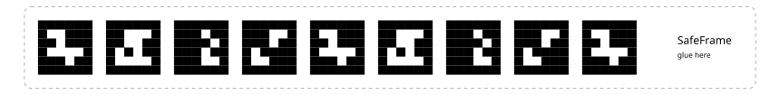
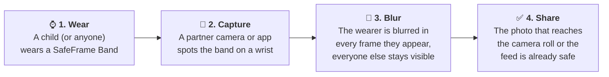

<div align="center">

# SafeFrame

### Wear it, and you're not in the picture.

*An IE Challenge project by the SafeFrame Crew*

[](https://github.com/issamarida/safeframe/actions/workflows/ci.yml)

</div>

<p align="center">
  
  <br>
  <sub><i>A SafeFrame Band (adult size, printable at home). Every band is identical.</i></sub>
</p>

---

## In one sentence

**The SafeFrame Band is a wristband that says "please don't show me": any
partner camera, app or platform that sees it blurs the person wearing it, and
only that person, before the photo or video is ever shared.**

---

## 📉 The problem

Every day, millions of photos and videos are taken at school plays, birthday
parties, football matches, parks and holidays, and then posted online. Most of
them include children. Some of those children belong to the person filming.
Many do not.

Once a child's face is online, it is very hard to take it back. A clip can be
copied, re-shared, searched and stored for years. The child had no say in it and
may only find out much later.

### The numbers

| | |
|---|---|
| **~1,500** | photos the average UK parent has posted of their child by the child's **fifth birthday**. Only **16 %** of parents always ask permission before posting a photo of someone else.<sup>[1]</sup> |
| **81 %** | of children across ten countries (including the UK, France, Spain and the US) already had a digital footprint **before age two**. In the US the figure was **92 %**.<sup>[2]</sup> |
| **74 %** | of parents of young children know another parent who has **shared too much** about a child online. **51 %** had seen posts revealing where a child could be found, and 27 % had seen inappropriate photos.<sup>[3]</sup> |
| **2×** | Children were **twice as likely as their parents** to worry about family members posting about them without permission. Asking permission first was the most common rule they wanted.<sup>[4]</sup> |
| **⅔** | of identity fraud facing young people could stem from "sharenting" by 2030, costing an estimated **£670 million a year**, according to a forecast by Barclays.<sup>[5]</sup> |

### Why this is getting harder, not easier

- **Everyone films everything.** Phones, action cameras and smart glasses mean a
  child can appear in dozens of strangers' videos in a single afternoon.
- **The person filming is rarely the parent.** Parents told us their biggest
  frustration is *other people's* recordings, from relatives, other parents,
  clubs and schools. They have little control over those.
- **Asking doesn't scale.** "Please don't post my child" is easy to forget,
  awkward to repeat, and impossible to enforce.
- **Blurring by hand is slow.** Hiding one child in a two-minute video means
  editing thousands of individual frames. Almost nobody does it.
- **The law is moving.** Europe's data-protection rules (GDPR) state that
  children *"merit specific protection"* with regard to their personal data.<sup>[6]</sup>
  In 2024 France passed a law making parents jointly responsible for protecting
  their children's image rights.<sup>[7]</sup> Schools, clubs and creators are
  increasingly expected to get this right.

---

## 💡 Our solution: the SafeFrame Band

Parents told us the footage that worries them most is the footage **they don't
control**. So instead of asking every person who films to remember to protect
every child, we let the child carry the request with them.



1. **Wear.** A child wears a band: printed at home on paper or sticker film,
   or woven into a wristband. It carries a row of square markers, a bit like
   tiny QR codes.
2. **Capture.** We partner with camera makers (for example the iPhone camera),
   recording apps and social platforms. Their software looks for the markers,
   and works out whose wrist they are on.
3. **Blur.** That person is blurred to the outline of their body, in **every**
   frame they appear in, including frames where the band is hidden behind their
   back. One sighting is enough. Everyone without a band is untouched.
4. **Share.** What gets saved or posted is already safe. No one had to
   remember anything.

This repository is the **reference implementation**: the detector, the rules,
the abuse protections and a web app that applies them to any photo or video
(the same thing a platform would run at upload time). Partners implement the
same rules on their devices, described in [docs/PROTOCOL.md](docs/PROTOCOL.md).

### Why a band, and why these markers

| Choice | Why |
|---|---|
| **A visible marker, not face recognition** | SafeFrame never needs to know *who* anyone is. It only needs to see a request. Nothing about the wearer is stored or matched. |
| **Every band is identical** | No serial number, no name. A band says "this person opted out", never "this is Lucía". Two sightings can't be linked, so **a band can't be used to find or follow a child**. |
| **Fiducial markers instead of a "bracelet classifier"** | The pattern either decodes or it doesn't, so every decision is explainable, it runs on every frame of a phone camera, and chance matches on clothing are rare. |
| **Printable at home** | A privacy request should not cost money. `GET /api/band.svg` or `safeframe band` prints an A4 sheet at true size. |

---

## 🏦 "Couldn't a robber wear one into a bank?"

This was the first question we asked ourselves, and the design answers it in
layers. **A band is a privacy request to the people sharing photos, never a
disguise from the people keeping you safe.**

| Layer | What happens | Why the robber loses |
|---|---|---|
| **1. Security cameras never honour it** | Only consumer capture and publishing (phone cameras, social apps) implement the band. Partner certification forbids it on CCTV, body cameras and any evidence device. | The bank's own cameras record the robber exactly as before. |
| **2. Guarded places honour it only for children** | Banks, ATMs, courts, police stations, airports, border crossings, government buildings, jewellers, pharmacies, casinos and prisons are *guarded zones*. There a band only protects someone with **positive evidence of being a child**. Location comes from the GPS the camera already records (and, in the partner protocol, from signed venue beacons indoors). | An adult's band, or a masked face with no age evidence, is **not honoured**. Standing next to a child wearing a band doesn't help either: each person is judged on their own face. |
| **3. Nobody can make the rules looser** | A user can mark a capture as guarded but can never un-guard a place the registry knows. The location is used once and never stored. | There is no switch to turn the protection off. |
| **4. Sealed originals** | Whenever someone *is* hidden because of their band, the unblurred original can be sealed instead of deleted: encrypted so that only a quorum of independent trustees (for example 3 of 5) can open it, for example on a court order. Envelopes expire after 30 days. | Evidence of a crime can still be recovered, but not by the uploader, the partner, SafeFrame or anyone acting alone. |

What it costs: in a guarded place an adult who genuinely doesn't want to be
photographed isn't protected by the band, and a child whose face isn't visible
isn't either. We think that is the right trade: those are exactly the places
where being identifiable is expected, and everywhere else the band always
works. The full threat model is in [docs/SAFETY.md](docs/SAFETY.md).

---

## 🤝 Built to be responsible

| Principle | What it means in practice |
|---|---|
| **Opt in, not guess** | People are blurred because *they asked*, not because a model guessed their age. Outside guarded places nobody's face is analysed at all. |
| **When unsure, blur it** | Still our team motto. If a band could belong to either of two people (two children holding hands), both are blurred. |
| **No blinking** | Once a band is seen, the blur stays for the person's whole time on screen, so there is no frame where they slip through. |
| **Hide the person, keep the moment** | The blur follows the outline of the wearer's body, so the stage, the room and everyone else stay visible. |
| **A human always decides** | The web app shows every decision before export. Keeping a band wearer visible takes an explicit "they agreed" confirmation. |
| **Nothing is kept** | Uploads are deleted as soon as the safe copy is ready; everything else is wiped after 24 hours. All metadata, including location, is removed from the output. |
| **Not a surveillance tool** | SafeFrame doesn't identify anyone, store faces, count sightings or report where a band was seen. Its only purpose is to *hide* people. |

### Honest limitations

- **It can only honour a band it can see.** A band hidden for the whole clip,
  too far away or motion-blurred is missed. Today's reference detector needs
  about **2 pixels per marker square**: roughly **3 m** from a 12 MP phone
  photo or 4K video with a standard lens, about 1.5 m at 1080p. Partner
  cameras that read the full-resolution sensor (and telephoto lenses) reach
  further. The web app warns when it sees a band it can't match to a person.
- **Non-partner cameras ignore it.** The band makes respecting the request the
  default where most photos are taken and shared; it can't stop someone
  determined to use a camera that doesn't support it. Publication-side checks
  (platforms running this detector at upload) close part of that gap.
- **In guarded places it relies on age estimation**, which is probabilistic
  and least accurate around 16–19. That is the price of not letting the band
  become a disguise.
- **Outlines can be imperfect.** The body outline can occasionally miss part of
  a person, such as a raised hand. Review the preview and draw a box where it
  looks thin.

### Event mode

Schools and clubs that publish event footage can switch on **event mode**,
which also blurs anyone who may be under 18, band or not (the approach of
SafeFrame v0.1). Faces are analysed for age only in this mode or, for band
wearers, in guarded places.

---

## 🔬 What we learned from our research

As part of the IE Challenge, each team member interviewed parents and carried
out secondary research on the market, competitors, academic studies and
regulation. All interviewees are anonymous.

**What we heard**

- Parents already protect their children in small ways. They limit who can see
  their posts, choose not to post at all, worry about photos being reused, and
  increasingly ask their children's opinion first.
- One parent asked other people to cover their child's face in photos. This is
  exactly the manual, easy-to-forget request the band automates.
- The biggest worry is not what parents post themselves but **what other
  people record and share**.

**What surprised us**

- **Not every parent wants blurring.** Some told us they would rather not post
  at all than share a blurred photo, because being recognised is part of what
  makes a family memory special. That is why the band is *opt-in*: only the
  people who ask are hidden, and everyone else appears as normal.
- Our interviews were small and informal. They show a real need but do not yet
  prove how many people would use or pay for a solution. We treat our ideas as
  hypotheses to test, not facts.

**What we still need to test**

1. **Acceptance:** How do children feel about wearing a band, and could it feel
   stigmatising or give false confidence?
2. **Range and reliability:** How often is a band missed at real distances,
   angles and lighting, and is a woven or reflective band better than paper?
3. **Adoption:** What would convince camera makers and platforms to support it,
   and regulators to recognise it as a valid privacy request?
4. **Guarded places:** Is the list of place types right, and how should venues
   that aren't in the registry be handled?

**How it could be adopted**

| Role | Who |
|---|---|
| Decision-makers | Parents and guardians |
| Wearers and beneficiaries | Children, who should have an age-appropriate voice in the choice, and any adult who opts out |
| Pilot customers | Schools, sports clubs and event organisers |
| Implementation partners | Camera makers, recording apps and social-media platforms |
| Trustees | Independent bodies (for example a data-protection authority, a child-rights NGO and a court-appointed custodian) |
| Policy audience | Legislators and regulators |

---

## 🌍 Social impact

- **Gives children a voice** in how their image is used, in line with the UN
  Convention on the Rights of the Child (Article 16, the right to privacy).<sup>[8]</sup>
- **Protects by default, without anyone remembering**: the request travels with
  the child, into other people's photos.
- **Keeps the moment**: only the people who asked are hidden.
- **Doesn't trade privacy for safety**: the band can't be used to track a child,
  and it can't be used to hide a crime.

---

## 🛠️ Try it

```bash
make install && make serve     # web app on http://127.0.0.1:8000
cd backend && uv run safeframe band -o band.svg      # print a band
uv run safeframe process party.jpg -o party-safe.jpg  # photos and videos
```

Setup, architecture and technical details are in
**[docs/TECHNICAL.md](docs/TECHNICAL.md)**; the partner protocol is in
**[docs/PROTOCOL.md](docs/PROTOCOL.md)**.

---

## 👥 The team: SafeFrame Crew

| Name | Role |
|---|---|
| **Javier Cruz Villarreal** | Project coordinator |
| **Issam Arida** | Research and interviews lead |
| **Christoph Rintz** | Backend and AI lead |
| **Kiril Petrovski** | Frontend (user interface) lead |
| **Xander Nainoa Chen** | Quality, documentation and safety review lead |
| **Jamie Blewett** | Presentation lead |

---

## 📚 Sources

1. Nominet / The Parent Zone, *Share with Care* survey of 2,000 UK parents (2016). [nominet.uk](https://nominet.uk/news/parents-oversharing-family-photos-online-but-lack-basic-privacy-know-how/)
2. AVG Technologies, *Digital Birth* study of 2,200 mothers in 10 countries (2010). [PCWorld coverage](https://www.pcworld.com/article/503775/nine_of_ten_us_kids_have_online_presence_by_age_two_study.html)
3. C.S. Mott Children's Hospital, *National Poll on Children's Health: Parents on social media* (2015). [mottpoll.org (PDF)](https://www.mottpoll.org/sites/default/files/documents/031615_sharenting_0.pdf)
4. Hiniker, Schoenebeck & Kientz, *Not at the Dinner Table: Parents' and Children's Perspectives on Family Technology Rules*, University of Washington and University of Michigan, 249 families (2016). [ScienceDaily](https://www.sciencedaily.com/releases/2016/03/160308135122.htm)
5. Barclays forecast on "sharenting" and identity fraud (2018). [4NI coverage](https://www.4ni.co.uk/northern-ireland-news/244952)
6. General Data Protection Regulation (EU) 2016/679, Recital 38. [gdpr-info.eu](https://gdpr-info.eu/recitals/no-38/)
7. French Law No. 2024-120 of 19 February 2024 on children's image rights. [Bird & Bird summary](https://www.twobirds.com/en/insights/2024/france/new-legal-framework-for-childrens-privacy)
8. UN Convention on the Rights of the Child, Article 16. [ohchr.org](https://www.ohchr.org/en/instruments-mechanisms/instruments/convention-rights-child)

*AI acknowledgement: AI assistants (including Claude by Anthropic) helped restructure this page from the
team's project materials and research documents, helped find and check the
statistics above, and helped build the reference implementation. The team
reviewed the final content.*

---

<div align="center">

<sub>SafeFrame is open source under the <a href="LICENSE">MIT licence</a>.</sub>

</div>
