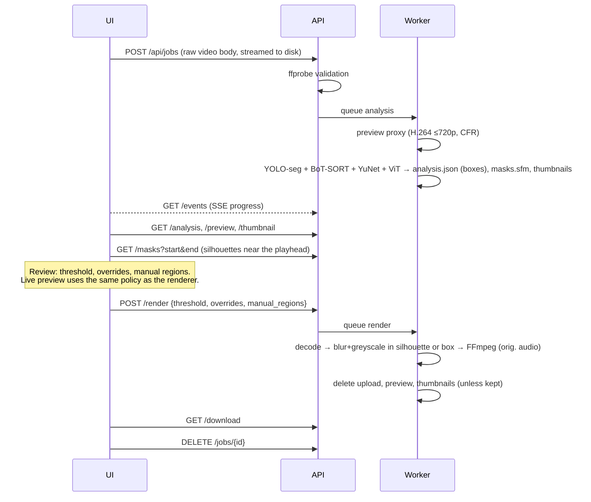

# Architecture

```
frontend/  React + Vite + TypeScript review UI
backend/   Python package `safeframe`
  src/safeframe/
    pipeline/   detection, tracking, age estimation, policy, smoothing, render
    video/      ffprobe / OpenCV decode / FFmpeg encode
    api/        FastAPI app, job manager, schemas
    cli.py      `safeframe process|analyze|render|serve`
    models.py   weight download + checksum verification
scripts/   repository hygiene checks
```

## Two-phase pipeline

Processing is split into **analysis** and **render** so that a human can review
between them, and so that changing the sensitivity threshold or overriding a
decision never needs the models to run again.



### Analysis (`pipeline/analyze.py`)

Per frame:

1. `PersonTracker.update(frame)` → `PersonObservation(track_id, box, conf, mask)`.
   The default `YoloPersonTracker` runs YOLO instance segmentation
   (`yolo11n-seg.pt`, `classes=[person]`, low confidence 0.1 so BoT-SORT's
   second association stage can keep tracks alive, `retina_masks=True`) with a
   tuned BoT-SORT config: a 3-second track buffer and appearance ReID so
   identities survive occlusion. The mask (if any) is stored on the track under
   the same zero-based frame index as the box; age sampling and thumbnails use
   boxes only.
2. Every `age_every` frames, for tracks still collecting evidence:
   `FaceDetector.detect(frame)` → faces → `assign_faces` gives each face to the
   person whose *expected head position* (top-centre of their box) is nearest,
   among people whose box contains the face in its top half. Faces with two
   near-equal candidates are dropped rather than guessed, because crediting an
   adult's face to a child would push the child toward "adult" → square crops →
   `AgeEstimator.estimate(crops)` in one batch → `AgeSample(p_minor,
   expected_age, weight)` appended to the track.

Silhouettes are streamed to the job's mask store as they are produced (see
below). After the last frame, samples are aggregated (`policy.aggregate`) and each track
is smoothed (`smoothing.smooth_track`): gaps ≤ 1.5 s are linearly interpolated,
and the first/last box is held for 0.25 s. Those synthetic frames get boxes
only: a silhouette is never copied to a new position or interpolated.

### Silhouettes (`pipeline/masks.py`, `pipeline/detection.py`)

**Alignment.** Masks come from the *same* tracked result as the boxes; there
is no second inference pass. In ultralytics 8.4.176 the tracker callback
(`trackers/track.py: on_predict_postprocess_end`) re-indexes the whole
`Results` with each surviving track's detection index (`result[idx]`), which
reorders `boxes` and `masks` together, then replaces the boxes with the
tracker's. A spike on three synthetic clips checked every tracked row's mask
against its own detection box: 0 mismatches over 971 rows, 131 of them in
frames the tracker had reordered. `tests/test_masks.py` pins the adapter
contract with reordered fake rows.

**Coordinates.** With `retina_masks=True`, Ultralytics upsamples prototypes and
removes the letterbox itself (`ops.process_mask_native` → `scale_masks`), so
`masks.data` is `(N, H, W)` at the decoded frame size. Any other shape is
discarded (box fallback), never stretched. Ultralytics crops each mask to its
detection box.

**Empty masks.** The segment predictor drops detections whose mask is empty
*unless* native ReID features are being captured. Our tracker config keeps
`with_reid: True, model: auto`, so no person box is lost; the tracker logs a
warning if that ever stops being true.

**Binarisation and coverage.** Foreground = mask logit > 0. The stored mask is
the final coverage: foreground dilated (elliptical kernel) by
`clamp(round(0.03 × longer box side), 3, 24)` px, clipped to the frame, never
clipped to the box.

**Quality gates** (raw mask vs. the frame-clipped box; failure → box fallback):
≥ 24 foreground px; foreground ≥ 12 % of box area; ≥ 90 % of foreground inside
the box grown by 15 %; IoU(mask extent, box) ≥ 0.3; ≤ 8 192 runs. Valid
geometry does not prove the person is fully covered.

**Mask geometry** (shared by the store and the legacy inline `masks_v1` field):
`[frame, x, y, width, height, runs]`, integer source pixels, half-open crop,
row-major run lengths alternating background/foreground starting with
background (first run may be 0, later runs > 0), summing to `width × height`.
Holes and disconnected parts are preserved.

**Mask store** (`pipeline/maskstore.py`, format `sfm1`). Inline JSON costs
~4 KB per person-frame (a 15 s, 4-person clip was 6.5 MB), so masks are kept
in a binary sidecar instead: a header with a random store id, the runs of each
mask as LEB128 varints (~1.2 KB per mask), then a fixed-size index sorted by
`(frame, track_id)` (44 bytes per entry) and a footer. The analysis JSON links
it with `mask_store: {"format": "sfm1", "file": "<basename>", "id", "entries"}`;
only a bare file name next to the analysis is accepted.

- *Writing.* `MaskStoreWriter` appends during analysis into
  `masks.sfm.partial` and renames it on success; failure or cancellation
  deletes the partial file. Budgets: 1 GiB per store, 1 M entries, 64 masks per
  frame, 8 192 runs per mask. Once a budget is hit every later mask uses the
  box (sticky, so the outcome does not depend on later mask sizes).
- *Reading.* `MaskStoreReader` checks magic, store id, footer and file size,
  requires the index to be strictly sorted (an unsorted or duplicate entry
  rejects the whole store), then drops entries that are out of bounds, on an
  unknown track, not on an observed box frame, or past the per-frame cap.
  Payloads are decoded and checked (exact varint count, positive runs, exact
  sum) only when a frame is requested; a bad payload makes that one mask
  missing. Render reads frame by frame; nothing holds every mask in memory.
- *Serving.* `GET /api/jobs/{id}/masks?start&end` returns validated rows
  (`masks_v1` geometry) grouped by track for at most 256 frames and 1 M runs,
  cut on a frame boundary; the response's `end` says where to continue.
  `GET /analysis` only reports `mask_store: {format, entries}`.
- *Measured* (synthetic, one hour of 4 people at 25 fps, 360 000 masks):
  406 MiB store, 0.28 s to open and validate the index (+20 MiB RSS), ~6 ms
  per frame to read 4 masks during render, 86 ms per 64-frame range
  (812 KiB JSON before gzip). The 1 GiB budget is about 2.5 hours of four
  people; beyond it frames use the padded box.
- *Retention.* `masks.sfm` lives in the job directory, is deleted with the
  job, by the sweeper, and together with the upload, preview and thumbnails
  after a successful export. The CLI writes it next to the analysis
  (`analysis.json` → `analysis.masks`); `process` uses a temporary directory.
  Masks are never logged.

**Legacy inline masks.** `Track.from_dict` still reads the `masks_v1` list on
each track (mirrored in `frontend/src/review/model.ts`): rows are validated
before anything area-sized is allocated, used only on observed box frames,
duplicates use the box, and budgets of 1.5 M runs per track and 4 M per
analysis apply in file order. `analyze_video` without a store writer keeps
masks inline within those budgets (used by tests).

All three components are `Protocol`s (`pipeline/interfaces.py`). Tests inject
scripted fakes, so the full pipeline — including FFmpeg encoding — is tested in
CI without downloading a single model.

### Decisions (`pipeline/policy.py`)

```
status = UNCERTAIN  if face_samples < min_face_samples
         MINOR      if P(under 18) >= threshold
         ADULT      otherwise
blur   = override if set, else status != ADULT
```

The frontend re-implements exactly this in `frontend/src/review/model.ts`, with
mirrored unit tests, so the browser preview matches the exported file.

### Render (`pipeline/render.py`, `pipeline/anonymize.py`, `video/io.py`)

`plan_render` turns analysis + policy + overrides + manual regions into a
`frame → [ProtectedRegion(box, mask?)]` map: blurred tracks contribute their
mask on frames that have one and their box otherwise; kept tracks contribute
nothing (so a Keep can never undo another region); manual regions are boxes.
`RenderPlan.boxes_for` still returns the fallback boxes, and
`coverage_stats()` counts silhouette vs. box person-frames (logged per job,
printed by the CLI).

`render_video` decodes with OpenCV (rotation-aware) and, per frame, computes
each region's effect from an untouched copy of the frame:
`gaussian_blur_strong` (downscale → Gaussian → upscale → Gaussian, sigma
proportional to the ROI) then greyscale, over the padded box grown to contain
the silhouette. The effect is written only where the region's coverage is true
(the mask, or the whole padded box), in plan order. Overlaps therefore never
restore original pixels and never blur already-blurred pixels. If a planned
region has neither a mask nor a finite, non-empty box, `RenderError` is raised
before that frame is written; the FFmpeg writer then aborts and deletes the
output, and a web job returns to review with the error.

### Review preview (`frontend/src/components/VideoStage.tsx`)

The canvas overlay picks the same mask-or-box per frame as the renderer.
`review/masks.ts` (`MaskChunkCache`) fetches 64-frame chunks around the
playhead (and the next chunk), continues truncated responses, re-validates
every row against the frame size and observed box frames, and keeps at
most 16 chunks. Until a chunk arrives, or if it fails, those frames are
previewed with the padded box, which is never less coverage than the export. For a
silhouette it rasterises the mask to preview pixels using separate x/y ratios
and a conservative rule (a preview pixel is covered if any covered source
pixel touches it; no partial alpha), draws the blurred video into an offscreen
canvas, keeps it only where the mask is opaque (`destination-in`), and
composites that onto the review canvas. Decoded rasters are LRU-cached (64).
Without Canvas filter support the same coverage is filled opaque grey. The
overlay sits on top of the unredacted preview; only the export has the blur
baked in.
Frames are piped as raw BGR into FFmpeg:

```
ffmpeg -f rawvideo -pix_fmt bgr24 -s WxH -framerate <exact rational> -i pipe:0
       -i <original> -map 0:v:0 -map 1:a? -c:a copy|aac
       -c:v libx264 -crf 18 -pix_fmt yuv420p -map_metadata -1 -movflags +faststart
```

## Jobs and retention (`api/jobs.py`)

- One job = one directory `data/jobs/<128-bit random id>/`. The id is the only
  handle to a job; it is validated against `^[0-9a-f]{32}$` before touching disk.
- Uploads are streamed from the request body straight into the job directory
  (no multipart temp files in shared `/tmp`), with the size limit enforced while
  streaming.
- A single worker thread runs analysis and renders sequentially (they share the GPU).
- After a successful render, `upload`, `preview.mp4`, `masks.sfm` and `thumbs/` are deleted
  unless the user opted to keep the upload.
- `DELETE /api/jobs/{id}` cancels any running work and removes the directory.
- A sweeper deletes jobs idle for longer than `SAFEFRAME_JOB_TTL_HOURS`
  (default 24) and any directory it does not recognise. On start-up, jobs that
  were interrupted mid-processing are deleted.
- Media responses carry `Cache-Control: no-store`.

SafeFrame is designed to run locally or on a trusted self-hosted machine. It
has no user accounts: anyone who knows a job id can access that job, so do not
expose the server to the internet without putting authentication in front of it.

## Configuration

| Variable | Default | Meaning |
| --- | --- | --- |
| `SAFEFRAME_DATA_DIR` | `data` | Job storage |
| `SAFEFRAME_MAX_UPLOAD_MB` | `4096` | Upload size limit |
| `SAFEFRAME_JOB_TTL_HOURS` | `24` | Delete jobs after this long without activity |
| `SAFEFRAME_DEVICE` | auto | `cpu`, `cuda`, `cuda:1`, `mps` |
| `SAFEFRAME_YOLO_WEIGHTS` | `yolo11n-seg.pt` | Ultralytics segmentation model (silhouettes) or detection model (boxes only); CLI: `--yolo` |
| `SAFEFRAME_AGE_MODEL` | `nateraw/vit-age-classifier` | Hugging Face image-classification model with age-range labels |
| `SAFEFRAME_AGE_MODEL_REVISION` | latest | Pin a model revision |
| `SAFEFRAME_MODEL_DIR` | `~/.cache/safeframe/models` | Weight cache |
| `SAFEFRAME_WARM_UP_MODELS` | `true` | Load models at start-up |
