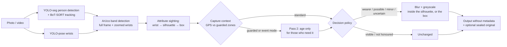

# SafeFrame: technical documentation

> This page is for developers. For a plain-language overview of the problem
> SafeFrame tackles and why, see the [main README](../README.md). Partners
> implementing the band on a camera or platform should read
> [PROTOCOL.md](PROTOCOL.md).

[](https://github.com/issamarida/safeframe/actions/workflows/ci.yml)

SafeFrame takes a photo or video, finds everyone wearing a **SafeFrame Band**
(a wristband printed with ArUco markers) and returns a copy in which those
people, and only those people, are blurred in every frame they appear in.
Everyone else and the background are left unchanged. In guarded places
(banks, courts, airports...) a band protects only people who look like
children, and the unblurred original can be sealed so that only a quorum of
trustees can open it. A human reviews every decision before anything is
exported.

## Intended use

SafeFrame is intended for **honouring people's request not to appear in
images that are going to be shared**: the reference for camera and platform
partners, and a self-service tool for parents, schools, clubs and creators.

It is **not** a surveillance, identification or age-verification system. It
must not be used to find, count, profile or track band wearers, its age
estimates (guarded zones and event mode only) are not evidence of anyone's
age, and it must never be deployed on security cameras.

> **A band SafeFrame can't see can't protect anyone.** Detection needs about
> 2 pixels per marker square (see [Limitations](#limitations)). Always review
> the result before sharing it.

## How it works



1. **Detect, segment and track people.** Ultralytics YOLO (`yolo11n-seg.pt`)
   finds and outlines each person; BoT-SORT with appearance re-identification
   links them into tracks. Identity comes from the *body*, so a person keeps
   the same ID while they turn around or are briefly occluded. Photos use
   untracked detection.
2. **Find bands.** Every second frame (every photo), OpenCV's ArUco detector
   looks for the four reserved markers of `DICT_4X4_50` on the full frame, and
   again on crops around each wrist found by `yolo11n-pose.pt`, upscaled to
   ~480 px (≤ 4×), where small markers are still decodable.
3. **Attribute each sighting** to the person whose wrist keypoint is within
   0.1 × body height, else whose silhouette contains it, else whose box does.
   Equally good fits protect all candidates (`possible`); sightings that fit
   nobody are reported as orphans.
4. **Resolve the capture context.** The location recorded in the file (EXIF
   GPS for photos, the ISO 6709 tag for video) is matched against the
   guarded-zone registry, once, and never stored. The uploader can declare a
   guarded place or event mode; neither can loosen a registry match.
5. **Estimate age only where it matters (pass 2).** In a guarded zone, only band
   wearers' faces are analysed; in event mode, everyone's. Outside them no face
   is cropped at all. Faces (OpenCV YuNet) are assigned to the person whose
   expected head position is nearest; a FairFace ViT gives P(under 18).
6. **Decide.** One sighting protects the whole track. See the decision table in
   [ARCHITECTURE.md](ARCHITECTURE.md#decisions-pipelinepolicypy).
7. **Smooth, blur, encode.** Gaps ≤ 1.5 s are interpolated and tracks padded by
   0.25 s. Protected people get a size-proportional Gaussian blur and greyscale
   inside their silhouette (grown by 3–24 px), or their padded box on frames
   without a reliable silhouette. Video is encoded by FFmpeg at the source's
   exact resolution and frame rate with the original audio; photos are
   re-encoded in their own format. All metadata is dropped.
8. **Seal (optional).** If anyone was hidden because of their band and an
   escrow key is configured, the original is encrypted to the trustee quorum
   (X25519 + AES-256-GCM, Shamir k-of-n) before it is deleted.

## Safety design

| Decision | Why |
| --- | --- |
| One sighting protects the whole track | A band only needs to be visible once; no frame leaks while it's hidden. |
| Ambiguous sightings blur every candidate | Missing the real wearer can't be undone; an extra blur can. |
| No age estimation outside guarded zones and event mode | Data minimisation: bystanders' faces are never analysed. |
| Guarded zones need positive evidence of a child | A band is a privacy request, not a disguise. |
| Context can only get stricter | No switch, flag or missing location can un-guard a bank. |
| Sealed originals with k-of-n trustees | Crime evidence stays recoverable, by nobody acting alone. |
| Identical bands, no logging of sightings | A band can't become a tracking beacon. |
| Body-based tracking, interpolation, padding | Decisions survive head turns and occlusion; no single-frame leaks. |
| Human review before export | The model proposes; a person decides. Keeping a wearer needs a consent confirmation. |
| No metadata in outputs | Shared images should not carry home GPS coordinates. |
| Footage, envelopes, shares, weights, secrets never committed | Enforced by a pre-commit hook and CI. |

## Quick start (web app)

Requirements: Python 3.11+, [uv](https://docs.astral.sh/uv/), Node 20+, FFmpeg.
A CUDA GPU is used automatically when available.

```bash
make install   # backend (uv, includes PyTorch) + frontend (npm)
make dev       # API on :8000, UI on http://localhost:5173
# or, production-style on a single port:
make serve     # builds the UI and serves it from FastAPI on http://127.0.0.1:8000
```

1. **Upload** a photo or video. Optionally mark it as taken in a guarded place,
   turn on event mode, or keep the original after export. "Print a band" opens
   the printable sheet.
2. **Watch progress** while people and bands are found.
3. **Review.** A banner states which rules apply. Each person shows why they are
   blurred or visible ("Wearing a band", "Possible band", "Band not honoured",
   "No band"...), with a link to the first sighting; the timeline marks every
   sighting. Override any decision (keeping a wearer asks for confirmation),
   draw extra regions, and check the live preview. Age sensitivity appears only
   where age can change a decision.
4. **Export** and download. If sealing is enabled and a band was honoured, the
   sealed envelope can be downloaded too. The original, preview and
   thumbnails are then deleted unless you chose to keep them.

## Quick start (command line)

```bash
cd backend
uv sync --all-extras                 # first run downloads PyTorch
uv run safeframe band -o band.svg    # A4 sheet: print at 100 %
uv run safeframe process street.jpg -o street-safe.jpg
```

```
NOTE: SafeFrame blurs people wearing a SafeFrame Band. A band it cannot see
cannot protect anyone, so review the output before sharing it.
analysing  [##############################] 100.0%
context: standard: every band is honoured
  person    1  frames      0-0      no band                       -> visible
  person    2  frames      0-0      band 1 clean / 0 ambiguous    -> wearer
  person    3  frames      0-0      no band                       -> visible
  person    4  frames      0-0      no band                       -> visible
wrote street-safe.jpg  (blurred: [2])
protected person-frames: 1 by silhouette, 0 by box fallback
```

The same photo, taken at the Banco de España:

```bash
uv run safeframe process street.jpg -o bank-safe.jpg --location 40.4184,-3.6943
```

```
context: GUARDED ZONE (Banco de España (Madrid)): bands protect only people who look like children
  person    2  frames      0-0      band 1 clean / 0 ambiguous    P(<18)=0.00 (1 faces)  -> not_honoured
wrote bank-safe.jpg  (blurred: nobody)
```

Useful options for `process`, `analyze` and `render`:

| Option | Meaning |
| --- | --- |
| `--location LAT,LON` | Capture location if the file has none (default: read from the file) |
| `--zones FILE` | Guarded-zone registry JSON (default: the packaged sample) |
| `--guarded` | Treat as captured in a guarded place |
| `--event-mode` | Also blur anyone who may be under 18 |
| `--seal-to escrow.pub.json` | Write `OUTPUT.sfseal` when a band is honoured |
| `--min-band-hits N` | Clean sightings needed for `wearer` (fewer is `possible`, still blurred) |
| `--threshold`, `--min-face-samples` | Age evidence rules (guarded zones and event mode) |
| `--yolo`, `--pose`, `--device` | Models and device; `--pose ''` attributes by silhouette/box only |

Analysis and rendering can run separately, so an analysis can be reviewed or
edited before rendering:

```bash
uv run safeframe analyze party.mp4 -o analysis.json
uv run safeframe render party.mp4 analysis.json -o party-safe.mp4
```

### Sealed originals and trustees

```bash
uv run safeframe trustees init -k 3 -n 5 --out keys/   # escrow.pub.json + trustee-1..5.json
uv run safeframe process clip.mp4 -o clip-safe.mp4 --seal-to keys/escrow.pub.json
uv run safeframe inspect clip-safe.mp4.sfseal          # public header: reason, context, expiry
uv run safeframe unseal clip-safe.mp4.sfseal --share t1.json t3.json t5.json -o original.mp4
```

Give each `trustee-N.json` to a different, independent custodian and delete
it from the machine that ran the ceremony. Only `escrow.pub.json` belongs on
the server. Fewer than k shares reveal nothing; expired envelopes are refused
unless `--allow-expired` is given.

Model weights are downloaded on first use to `~/.cache/safeframe/models`
(override with `SAFEFRAME_MODEL_DIR`) and the Hugging Face cache; YuNet is
verified against a pinned SHA-256.

## HTTP API

`uv run safeframe serve` starts the FastAPI server on `127.0.0.1:8000`
(interactive docs at `/docs`).

| Method & path | Purpose |
| --- | --- |
| `GET /api/config` | Limits, defaults, sealing settings, band spec version, notice and intended-use statement |
| `GET /api/band.svg` | Printable A4 sheet of child and adult bands |
| `POST /api/jobs?filename=…&keep_upload=false&guarded=false&protect_minors=false&location=lat,lon` | Upload a photo or video as the raw request body; starts analysis. `location` is optional and never stored |
| `GET /api/jobs/{id}` | Job state, stage, progress, media type, capture context, `sealed_ready` |
| `GET /api/jobs/{id}/events` | Server-sent events stream of job progress |
| `GET /api/jobs/{id}/analysis` | Tracks with per-frame boxes, optional `masks_v1` silhouettes, band sightings, age evidence where computed, capture context, orphan sightings (gzip when accepted) |
| `GET /api/jobs/{id}/preview` | Browser-playable preview (supports range requests) |
| `GET /api/jobs/{id}/tracks/{track}/thumbnail` | Review thumbnail for one person |
| `POST /api/jobs/{id}/render` | `{threshold, min_face_samples, min_band_hits, overrides, manual_regions}`; starts export |
| `GET /api/jobs/{id}/download` | The blurred photo or MP4 |
| `GET /api/jobs/{id}/sealed` | The sealed original (`.sfseal`), when one was written |
| `DELETE /api/jobs/{id}` | Cancel and delete everything for the job |

**Data retention.** The original upload, the preview and the thumbnails are
deleted as soon as the export is ready unless `keep_upload=true`. Every job is
deleted after 24 h without activity (`SAFEFRAME_JOB_TTL_HOURS`), interrupted
jobs are deleted on restart, and `DELETE` removes everything immediately. See
[ARCHITECTURE.md](ARCHITECTURE.md) for the full lifecycle and configuration,
and [SAFETY.md](SAFETY.md) for the safety case and threat model.

SafeFrame has no user accounts and is meant to run locally or on a trusted
self-hosted machine; put authentication in front of it before exposing it.

## Limitations

- **Detection range.** The reference decodes reliably at about 2 px per marker
  module. With a typical phone lens that is roughly 3 m for a child band in a
  12 MP photo or 4K video, and 1.5 m at 1080p; full-body people in a 1080p
  frame are usually too far. Shoot at the highest resolution available.
- **A hidden band is a missed band.** If the band never faces the camera, the
  wearer isn't protected. Orphan sightings are flagged, but a band that is
  never seen leaves no trace.
- **Guarded zones depend on location and age.** A file without location
  metadata, taken in a bank, is treated as standard unless the uploader marks
  it. In guarded zones, a child the age model misjudges as adult is not
  protected (by design: see [SAFETY.md](SAFETY.md)).
- **Incomplete silhouettes.** A mask can miss part of a person (a raised hand,
  hair) even when it passes the geometry checks; use a manual region where
  coverage looks thin. `--yolo yolo11n.pt` restores rectangle-only blurring.
- **Silhouettes on long videos** are capped by inline payload budgets (about
  4 000 person-frames per video); beyond that frames use the padded box.
- **Identity switches** in dense crowds can move a decision to the wrong person;
  interpolation and padding reduce but do not eliminate this.
- **Variable frame rate** input is rendered at its average frame rate.

## Model licences

SafeFrame's code is MIT licensed. The models it downloads have their own terms:
Ultralytics YOLO, including the default `yolo11n-seg.pt` and `yolo11n-pose.pt`
weights (AGPL-3.0 or Ultralytics Enterprise licence), OpenCV YuNet (MIT), and
`nateraw/vit-age-classifier` (see its model card; trained on FairFace, CC BY
4.0). ArUco detection is part of OpenCV (Apache 2.0) and needs no weights.
Review these before any commercial deployment.

## Development

See [CONTRIBUTING.md](../CONTRIBUTING.md) for the branching model, commit
conventions and data-handling rules, and [DEVELOPMENT.md](DEVELOPMENT.md) for
the code layout and testing notes.

```bash
make test          # backend (synthetic video, no model downloads) + frontend suites
make test-models   # real-model tests: bands pasted onto sample photos (downloads models)
make lint
```

## License

[MIT](../LICENSE) © 2026 Issam Arida
